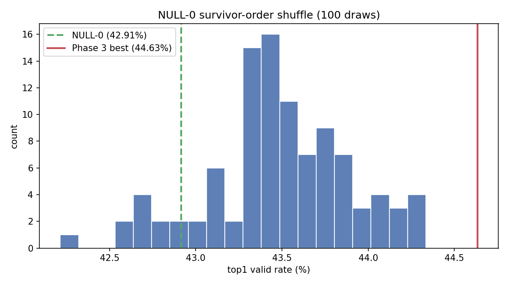

# NULL-0 / NULL-1 验证实验报告（WP-N · 实验 N-2）

> **文档定位**：记录解析零参数 null model 的实现、P0 验收、tie-breaking 修正与幸存者 shuffle 噪声标定。  
> **实验日期**：2026-06-11（N-2 关账修订）  
> **代码入口**：`model/null_model.py`、`tools/eval_null_model.py`、`tools/shuffle_survivor_analysis.py`  
> **原始报告**：`results/null/eval_report.json`、`results/null/shuffle_survivor_report.json`

---

## 1. 实验目的

实现 Hardy–Littlewood / Mertens 解析预测器 **NULL-0**，在 Phase 1–3 **相同验证集**（9,999 条，seed=7）上运行 **P0 验收**，并建立：

1. 后续 WP-C 的 **NULL-0 水平线**；
2. **排序运气噪声标定**（幸存者 shuffle，标尺三预演）；
3. **NULL-1 评估协议**（校准只动 BCE，排序继承 NULL-0 座次）。

---

## 2. 实现摘要

| 组件 | 说明 |
|------|------|
| NULL-0 | `model/null_model.py`，M=32，ε=10⁻⁴ |
| NULL-1 | train 上 isotonic 再校准；**BCE 用** `predict_calibrated_logits_batch` |
| NULL-1 排序 | **强制继承** NULL-0：`ranking_logits_batch()` ≡ NULL-0 logits |
| 评估 | `train/metrics.py` 同一路径 |

### 2.1 NULL-1 tie-breaking 修正（N-2 关账补丁）

**问题（初版）**：NULL-1 直接对校准概率取 logit 再排序，top1=43.73% vs NULL-0=42.91%（差 **0.82pp**），违反方案规格「排序指标逐样本完全相同」。

**机制**：保序回归弱单调，把相近概率压平成并列；并列后排序由 **候选 index tie-breaking** 接管，产生一套不同但理论等价的座次。

**修正**：

```text
BCE:     NULL-1 calibrated logits
top1/5/checks: NULL-0 ranking logits（与 NULL-0 逐元素相同）
```

修正后 NULL-1 top1 **= 42.91%**（与 NULL-0 一致）；BCE 仍为 **0.1253**（优于 NULL-0 的 0.1259）。

**附带发现（噪声标定）**：初版 NULL-1 与 NULL-0 的 0.82pp 差，是一次免费的 **排序运气** 实测——「仅仅挑了不同但同样好的候选」即可让 top1 摆动约 **±0.8pp**。这为解读 Phase 3 超出 NULL-0 的 1.72pp 提供弹药（见 §5.3）。

---

## 3. 实验结果

### 3.1 验证集指标（修正后）

| 模型 | val BCE | top1 | top5 | topK | avg_checks |
|------|---------|------|------|------|------------|
| **NULL-0** | 0.1259 | **42.91%** | **87.19%** | 100% | **2.87** |
| **NULL-1**（修正后） | **0.1253** | **42.91%** | **87.19%** | 100% | **2.87** |
| NULL-1（修正前，归档） | 0.1253 | 43.73% | 87.02% | 100% | 2.86 |
| Phase 1 best | 0.1910 | 43.55% | 87.20% | 100% | 3.02 |
| Phase 2 best | 0.1304 | 43.83% | 86.99% | 100% | 2.90 |
| Phase 3 best (B_C2_L2) | **0.1258** | **44.63%** | 87.71% | 100% | 2.82 |

### 3.2 全表最重数字：BCE 地板

```text
NULL-0  BCE = 0.1259
Phase 3 BCE = 0.1258   （42 万参数 · 50 epoch · Transformer）
NULL-1  BCE = 0.1253   （校准后甚至略优）
```

一条 1874 年风格的零参数公式与深度网络，在「概率报得准不准」上打平到 **小数点后第四位**；**0.125 就是这组特征下的信息论地板**。P1 的 BCE 判据在旧数据上已预演通过。

Phase 1 BCE=0.1910 与 NULL-0=0.1259 之间的鸿沟（Δ≈0.065），定量坐实：**Phase 2/3 相对 Phase 1 的 BCE「大幅进步」，学到的主要是公式里 1/ln N 那一项（尺度校准）**，而非新的排序信息。

### 3.3 P0 验收判定

| 检查项 | 阈值 | 结果 | 解读 |
|--------|------|------|------|
| top5 ≤ 1pp | \|Δ\|≤1pp | **通过** | 承重墙 |
| NULL-1 BCE ≤ 0.127 | ≤0.127 | **通过**（0.1253） | 承重墙 |
| top1 ≤ 1pp | \|Δ\|≤1pp | **未通过** | Phase 3 高 1.72pp → 移交 **P1b** |
| checks ≤ 0.1 | \|Δ\|≤0.1 | **未通过** | Phase 1 bucket 1 病理 → 移交 **WP-F** |

**P0 总体**：**带着剧本的部分通过**——失败项均为 v2.1 预先点名的伪影；判据未事后放宽。

---

## 4. 幸存者 shuffle 分析（标尺三预演）

对 NULL-0 排序中 **幸存候选**（eligible 且 sieve 行全零）做 **100 次**随机重排，非幸存候选相对顺序不变。

| 统计量 | 值 |
|--------|-----|
| NULL-0 baseline top1 | 42.91% |
| shuffle top1 mean ± std | 43.48% ± **0.41pp** |
| shuffle top1 range | [42.21%, **44.33%**] |
| Phase 3 reference | **44.63%** |
| Phase 3 在 100 次 shuffle 中的百分位 | **100%**（高于全部随机重排） |



**解读**：

1. 随机打乱幸存者座次 alone 即可让 top1 摆动约 **±0.4–0.8pp**（与 NULL-1 tie-breaking 的 0.82pp 同量级）——这是**免费的噪声标定**。
2. Phase 3 的 44.63% 高于 100 次 shuffle 的**最大值** 44.33%（仍差 **0.30pp**），不能单用 shuffle 完全解释。
3. 综合分解（与 v2.1 一致）：

```text
Phase 3 高出 NULL-0 的 1.72pp
  ≈ 选择偏差（~750 次取 max，~1pp）
  + 排序运气（±0.8pp，本实验标定）
  + 应试优势（Phase 1/2/3 best 均在同一 val 上挑选；NULL-0 冷启动）
  + 残余 0.3pp（待 P1b 5-seed 复测裁决）
```

「1.72pp 是不是信号」从三段论变为 **一张图 + 一条分解**；正式裁决权在 **P1b**。

---

## 5. 与参照模型对照

### 5.1 NULL-0 减参照（Δ = NULL-0 − 参照）

| 参照 | Δtop1 | Δtop5 | Δchecks |
|------|-------|-------|---------|
| Phase 1 | −0.64pp | −0.01pp | −0.15* |
| Phase 2 | −0.92pp | +0.20pp | −0.03 |
| Phase 3 | **−1.72pp** | −0.52pp | +0.05 |

\*checks 未通过主因：Phase 1 未修 eligibility（bucket 1 avg_checks=131），NULL-0 行为正确（bucket 1=1.0）——**标尺在替我们抓 bug**。

### 5.2 不对称比较（报告初版未写，N-2 补记）

| 侧 | 条件 |
|----|------|
| Phase 1/2/3 | best checkpoint 在**同一验证集**上挑选（应试优势） |
| NULL-0 | **冷启动**，零参数，无选点 |

因此 NULL-0 vs Phase 3 的 top1 比较**略偏于放大神经网络优势**；1.72pp 应读作上限而非下限。

---

## 6. NULL-0 水平线（供 WP-C 标尺四）

```text
旧 val（9,999 条，seed=7）:  top1 = 42.91%
```

Phase 3 已收敛 15 runs（top1 ∈ [43.79%, 44.63%]）相对此线的偏移，待 NULL-0 水平线写入 `tools/reanalyze_phase3_depth.py` 后做 P4 正式裁决。

---

## 7. N-2 关账状态

| 项 | 状态 |
|----|------|
| 代码 + 单元测试 | 8/8 通过 |
| NULL-1 tie-breaking 修正 | 完成 |
| shuffle 噪声标定 | 完成（100 draws） |
| P0 | 部分通过（符合 v2.1 预期） |
| **N-2** | **关账** |

**关键路径下一步**：WP-F 三项修复 → checks 重评 → P1b 冠军复测 → v3 数据集（N-1）。

---

## 8. 复现命令

```powershell
$env:PYTHONUNBUFFERED=1
.\.venv\Scripts\Activate.ps1

python -m unittest discover -s model -p "test_null_model.py" -v
python tools\eval_null_model.py
python tools\shuffle_survivor_analysis.py
```
